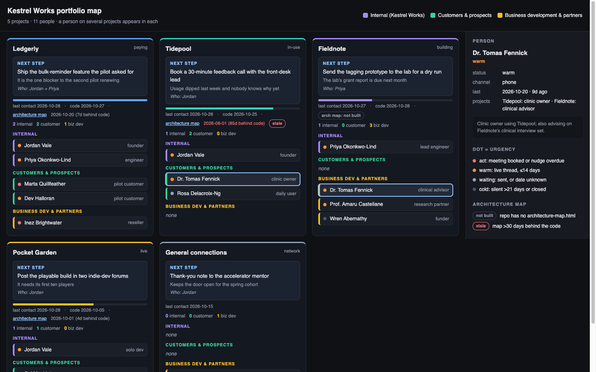

# Startup Map

A Claude Code plugin for people running several projects at once. It draws two
kinds of single-file HTML maps:

- **portfolio-map**: one card per project with its stage, the next step (what,
  why, who), freshness (last contact, last commit, architecture-map status), and
  every person attached to it, colour-coded internal / customer / business
  development with an urgency dot. Click a person and they light up on every
  card they belong to.
- **architecture-map**: a C4-style container diagram of one code repo, built
  from the code itself (not the docs), with drill-down, data-flow drawers and a
  networking toggle.

The portfolio map is the front door. Cards whose repo has no architecture map,
or one more than 30 days behind the code, are badged **not built** / **stale**,
and the skill offers to build them. The architecture map also works on its own.



Mobile: [docs/screenshot-mobile.png](docs/screenshot-mobile.png). Both show the
fictional example data in `examples/map-data.json`.

## Install

From a local clone:

```bash
claude plugin marketplace add ./startup-map
claude plugin install startup-map@startup-map
```

From GitHub (once published):

```bash
claude plugin marketplace add <owner>/startup-map
claude plugin install startup-map@startup-map
```

Or try it for one session without installing: `claude --plugin-dir ./startup-map`.

## Use

In Claude Code:

- `/startup-map:portfolio-map` (or "map my projects"). It asks where your data
  file lives (default `./portfolio/map-data.json`) and what to do: build,
  refresh, rebuild or add. It proposes projects and stages and waits for your
  corrections before writing anything.
- `/startup-map:architecture-map` (or "map the architecture of this repo").
  Saves `architecture-map.html` at the repo root.

Rebuild the portfolio page yourself at any time (Python 3.9+, stdlib only):

```bash
python3 skills/portfolio-map/scripts/build.py path/to/map-data.json [out.html]
python3 skills/portfolio-map/scripts/build.py --selftest
```

Try it on the example: `python3 skills/portfolio-map/scripts/build.py examples/map-data.json`
(the example's repo paths do not exist, so its cards say "repo not found").

## Your data stays yours

The plugin holds no personal data. Your `map-data.json` lives in your own
project, and the generated HTML embeds it, so treat both as private. The
data format is documented in `skills/portfolio-map/SKILL.md`.

## License

MIT, see [LICENSE](LICENSE).
